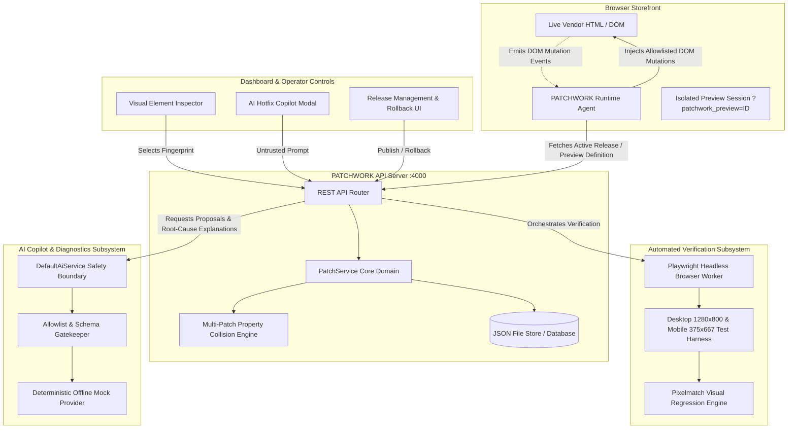
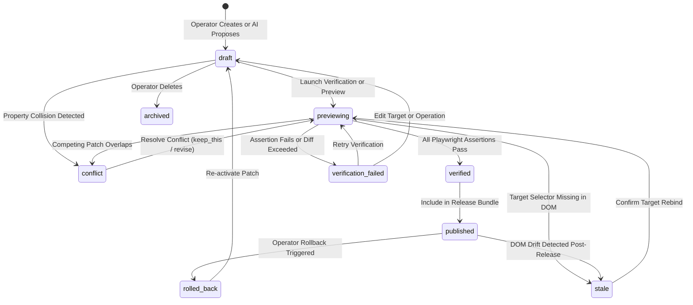

# PATCHWORK — System Architecture & Technical Specifications

> Autonomous DOM Patching, Multi-Signal Drift Recovery, and Playwright Verification Gate for Production Web Applications.

---

## 1. High-Level System Architecture

PATCHWORK operates as an out-of-band mutation and verification layer that safely modifies third-party web storefronts without modifying vendor source code or requiring CI/CD redeployments.

---

## 2. Multi-Signal Target Fingerprinting & Drift Recovery

Static CSS selectors break whenever vendor frontend deploys change class names, IDs, or wrapper hierarchies. PATCHWORK captures a **multi-signal fingerprint** of every target element and computes weighted matching scores when drift occurs:

```mermaid
flowchart LR
  DriftDetected[Selector Query Fails on Live DOM] --> Scanner[Multi-Signal DOM Scanner]
  
  subgraph Signals [Weighted Signal Matrix]
    S1[Tag Match: Weight 0.25]
    S2[Text & Substring Match: Weight 0.25]
    S3[Aria & Role Context: Weight 0.20]
    S4[Parent Container Context: Weight 0.15]
    S5[Stable Attributes: Weight 0.15]
  end

  Scanner --> Signals
  Signals --> Scorer[Composite Confidence Calculation]

  subgraph Tiers [Confidence Tiers]
    High[Score >= 0.85: High Confidence]
    Review[0.60 <= Score < 0.85: Review Required]
    Low[Score < 0.60: Low Confidence / Stale]
  end

  Scorer --> Tiers
  Tiers --> OperatorPrompt[Operator Review & Rebind Confirmation]
  OperatorPrompt --> PlaywrightGate[Mandatory Playwright Re-Verification Gate]
```

### Signal Weights and Calculation:

| Signal Component | Weight | Matching Mechanism |
|---|---|---|
| `tag` | **0.25** | Exact HTML tag name equality (`<button>`, `<a>`, `
`) |
| `text` | **0.25** | Exact text match (1.0), case-insensitive substring (0.75), or token overlap |
| `role` & `accessibleName` | **0.20** | ARIA role match and accessible text content |
| `parentContext` | **0.15** | Ancestor container `#id` or `.class` stability |
| `attributes` | **0.15** | Stable attributes (`type="submit"`, `name="checkout"`, data attributes) |

---

## 3. Formal Patch & Release Lifecycle State Machine

Patch mutations adhere to an immutable state machine enforced at the domain service layer. Unverified patches can **never** enter production releases.

---

## 4. Deterministic Conflict & Collision Detection

When multiple independent teams create patches targeting the same application, mutations can collide. PATCHWORK implements a deterministic collision detector:

- **Collision Criteria:**
  Two patches $P_A$ and $P_B$ collide if:
  $$\text{targetSelector}(P_A) == \text{targetSelector}(P_B) \quad \land \quad \text{operationProperty}(P_A) == \text{operationProperty}(P_B)$$
- **Non-colliding Coexistence:**
  Patches targeting the *same* element on *different* CSS properties (e.g., `background-color` and `border-radius`) or distinct elements are guaranteed to execute cooperatively in deterministic version order.
- **Interactive Resolution Strategies:**
  1. `keep_this`: Retains Patch A, marks competing Patch B as superseded, and requires re-verification.
  2. `revise_value`: Mutates Patch A with an operator-edited value, creating an immutable revision.
  3. `discard`: Immediately archives the patch in favor of the competitor.

---

## 5. Automated Playwright Verification & Gate Enforcement

Production releases are gated behind automated headless browser verification:

1. **Ephemeral Sandboxing:** A headless Chromium instance boots up and loads the storefront in isolation.
2. **Dual-Viewport Execution:** Tests execute across **Desktop (1280x800)** and **Mobile (375x667)** viewports.
3. **Multi-Assertion Harness:**
   - Target element existence and single-match uniqueness.
   - Mutation verification (computed CSS styles or DOM attributes match expected patch values).
   - Target visibility and accessibility bounding box verification.
   - Zero uncaught browser JavaScript exceptions in the console.
   - **Pixel Diff Regression:** Compares baseline vs. patched screenshots; diffs exceeding 10% fail verification automatically.

---

## 6. AI Safety Guardrails & Untrusted Boundary

The AI Hotfix Copilot is designed with strict defensive principles:

- **Untrusted Proposals:** AI output is treated as raw, untrusted user input. The server validates every proposal against [`validateAiProposal`](file:///c:/Users/blais/Desktop/Full-Stack-Projects/MewThree_college_round/packages/contracts/src/ai.ts) and [`validatePatchOperation`](file:///c:/Users/blais/Desktop/Full-Stack-Projects/MewThree_college_round/packages/contracts/src/operations.ts).
- **Zero Arbitrary Execution:** Script-based operations (`script.eval`, `window.eval`) are strictly blocked at the contract level.
- **Mandatory Verification Gate:** The server blocks any release containing a patch with status other than `verified`. AI cannot publish patches or bypass verification.
- **Zero API Key Requirement:** Includes a deterministic [`MockAiProvider`](file:///c:/Users/blais/Desktop/Full-Stack-Projects/MewThree_college_round/packages/server/src/ai.ts) enabling full automated testing and offline demos without external credentials.
